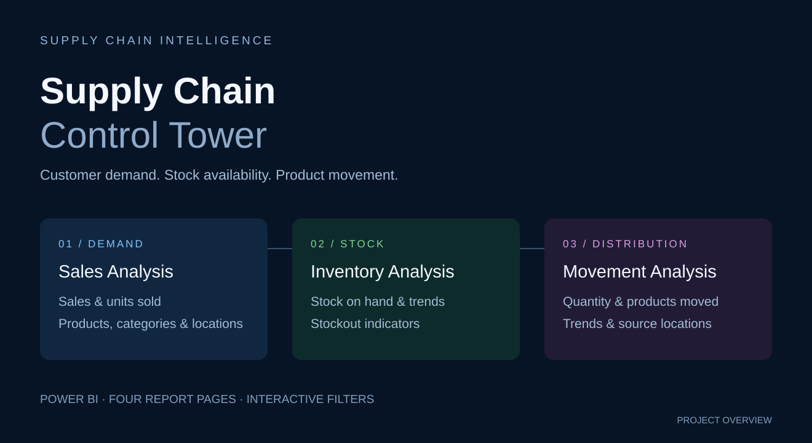

# Supply Chain Control Tower

A four-page Power BI report connecting retail sales, stock availability, and inventory movement.

*Project overview illustration; open the PBIX to explore the actual dashboard.*

## Latest report

[Download Supply Chain.pbix](Supply%20Chain.pbix?raw=true) — updated to the **Control Tower** version on November 6, 2026. The existing filename is retained so existing download links continue to work.

## Report pages

| Page | What it shows |
| --- | --- |
| Home | Control Tower landing page linking customer demand, stock availability, and distribution, with navigation to each analysis page. |
| Sales Analysis | Total sales, units sold, category trends, and sales by product and location. |
| Inventory Analysis | Quantity on hand, inventory trends, and low-stock / stockout indicators across products, locations, and time. |
| Movement Analysis | Quantity and products moved, movement over time, and absolute movement volume by product and source location. |

## Explore the report

1. Download the PBIX and open it in Power BI Desktop.
2. Use the Home buttons or sidebar to move between analysis pages (Ctrl+click for navigation in Desktop edit mode).
3. Use the year and month filters; sales and inventory pages also provide location filtering.

The Control Tower version introduces a consistent dark blue, green, and purple visual identity and clearer supply-chain stage labels. It retains the existing model, measures, charts, and filters from the styled report.

## Files

- **Supply Chain.pbix** — current Control Tower report.
- **control-tower-overview.svg** — conceptual project cover.
- **archive/Supply Chain dashboard - legacy.pdf** — previous version's PDF, retained for reference. It does **not** represent the current Control Tower design.

Power BI Desktop is required to explore the PBIX. Refreshing on another computer may require updating the original data-source paths or credentials in Power Query.
